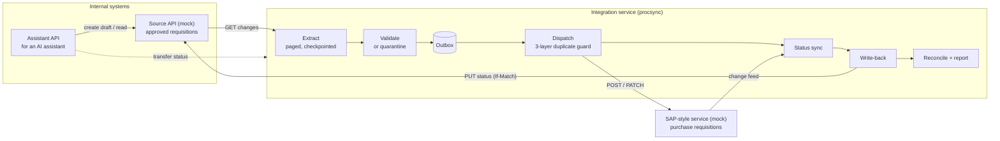

# Procurement Requisition Integration

An integration service in .NET 10 that reads approved purchase requisitions from an internal API, transfers them to an SAP-style service, and keeps their procurement status in sync. It is built to survive what real integrations hit: paging, rate limits, version conflicts, intermittent failures and malformed records. A rerun never creates a duplicate, and every outcome is explained in a reconciliation report.

It also includes an **AI-safe API contract** that a procurement assistant could use to raise requests and check their status, with the safety rules enforced by the server rather than trusted to the model.

All data is synthetic. By default everything runs on **the client's synthetic data pack**, read straight from the Excel workbook in [`data/`](data). The first run matches all 120 rows of its `Reconciliation_Expected` sheet. No real SAP system is involved.

---

## Contents

| Deliverable | Where |
|---|---|
| Source code | [`src/`](src) |
| Client's data pack, how it is used, and our assumptions | [`data/README.md`](data/README.md) |
| API specifications (OpenAPI 3.1) | [`api/assistant-api.openapi.json`](api/assistant-api.openapi.json), [`api/source-mock.openapi.json`](api/source-mock.openapi.json), [`api/sap-mock.openapi.json`](api/sap-mock.openapi.json) |
| AI assistant contract guide + MCP tool definitions | [`api/README.md`](api/README.md), [`api/mcp-tools.json`](api/mcp-tools.json) |
| Architecture note | [`docs/architecture.md`](docs/architecture.md) |
| Design decisions (ADRs) | [`docs/adr/`](docs/adr) |
| Test scenarios | [`docs/test-scenarios.md`](docs/test-scenarios.md) |
| Sample reconciliation reports | [`reports/sample/`](reports/sample): [first run on the client's data](reports/sample/workbook-first-run.md), [generated data under chaos](reports/sample/chaos-run-generated.md) |
| Presentation notes | [`docs/presentation-notes.md`](docs/presentation-notes.md) |
| Execution instructions | this file |

---

## Quick start

**Prerequisite:** [.NET 10 SDK](https://dotnet.microsoft.com/download/dotnet/10.0). Nothing else: no Docker and no database server. The integration uses SQLite by default.

```bash
dotnet test                  # 106 tests, about 40 seconds
scripts/demo.sh              # guided demo (macOS/Linux); Windows: scripts/demo.ps1
```

The demo starts three local services on the client's workbook. It runs the sync through the workbook's failure schedule and checks the result against the workbook's expected outcomes. It then walks through quarantine, status sync, the AI assistant API (signed in as the workbook's employees) and reconciliation. It takes about 90 seconds, mostly the workbook's 20-second `Retry-After` waits. Press Enter between steps, or pass `--no-pause` (`-NoPause` in PowerShell). Stop the services afterwards with `scripts/stop-all.sh` (or `scripts/stop-all.ps1`).

### Running the pieces yourself (any OS)

```bash
dotnet build
dotnet run --project src/Mocks.SourceApi            # terminal 1 → http://localhost:5101
dotnet run --project src/Mocks.SapApi               # terminal 2 → http://localhost:5102
dotnet run --project src/Procurement.AssistantApi   # terminal 3 → http://localhost:5103
dotnet run --project src/Procurement.Sync.Worker -- run   # terminal 4, from the repository root
```

Or start the three services in the background with `scripts/run-all.sh` / `scripts/run-all.ps1`.

Each service has interactive API docs at `/scalar` (for example http://localhost:5103/scalar). Every run writes a report to `reports/` (open `reports/latest.html`; per-requisition rows are also in `reports/latest.csv`) and keeps its state in `procsync.db` in the directory you run from. After the first run, `procsync check-expected` compares that run with the workbook's expected outcomes.

The mocks serve the client's workbook unless told otherwise. To use the generated 250-record stress set instead, call `POST /_admin/reset?dataset=Generated` on both mocks (see [`data/README.md`](data/README.md#data-sets)). If you ran an earlier version, delete `procsync.db` first, because the state store gained a column.

---

## What it does



One **run** does the following, in order:

1. **Extract.** Reads every source change since the last checkpoint, page by page.
2. **Validate.** Checks each record on its own and quarantines the bad ones with a reason code.
3. **Stage.** Puts valid records in an outbox.
4. **Dispatch.** Sends them to SAP, after first looking SAP up by reference.
5. **Status sync.** Pulls SAP status changes.
6. **Write-back.** Writes the SAP number and status back to the source.
7. **Report.** Writes a reconciliation report that checks invariants against a full scan of SAP.

---

## How the requirements are met

| Requirement | Approach | Proven by |
|---|---|---|
| Read approved requisitions | Change-ordered keyset paging with a durable cursor; non-approved records are tracked as `Ignored` | S01, S02 |
| Transfer to SAP-style service | OData-flavoured mock (`A_PurchaseRequisitionHeader`, `to_PurchaseReqnItem`, ETags, SAP error format) | S01, mock tests |
| Read and sync status | SAP change feed with a watermark; statuses only move forward; written back with `If-Match` | S09, S16, S18 |
| **Pagination** | Opaque keyset cursor; checkpoint committed with each page; dedupe on `(id, version)` | S03, S12, mock tests |
| **Rate limits** | Client token bucket, `429` + capped `Retry-After`, exponential backoff with jitter | S06 |
| **Version conflicts** | ETag / `If-Match` on both systems, a clear ownership rule, re-read and re-apply on `412`, re-read the source and resend on SAP's `409` version conflict, quarantine once SAP has frozen the record | S11, S13, S18, W01 |
| **Intermittent failures** | Microsoft's standard resilience handler (retry, circuit breaker, timeouts); unknown outcomes go `InDoubt` and are checked before any resend | S04, S07, S08, S15 |
| **Malformed records** | Each record is parsed on its own with field-level problems, then business rules; closed set of reason codes | S01 (all 11 defect types) |
| **Reruns never duplicate** | (1) local SAP-number mapping, (2) deterministic `Idempotency-Key`, (3) lookup by external reference before every create; a `409` "already exists" from SAP is adopted | S02, S04, S05, S20, W04, W05 |
| **Failed records quarantined** | `Quarantine` table with raw payload; auto-released when the source fixes the record; replay and resolve commands | S10, S21, S22 |
| **Reconciliation report** | JSON + Markdown + HTML per run: six invariants checked against a SAP scan, totals per currency, every failure with a suggested action | S19, S20 |
| **AI-safe API contract** | Draft-only, catalogue pricing, user confirmation bound to the exact request, required idempotency key, strict schema, scoped tokens and ownership, actionable errors, MCP hints | A01-A10, W07 |
| Synthetic data only | The client's workbook, read as-is; plus a deterministic generated set with fictitious codes and `example.test` addresses | W01–W07 |
| **Client's expected outcomes** | Per-requisition report rows in the same columns as `Reconciliation_Expected`; `procsync check-expected`; tests compare every expected-outcome sheet | W01–W03, W07 |

**On the client's workbook** (120 requisitions: 115 approved, 5 pending), the first run produces:
- **58 created** in SAP, with the workbook's document numbers;
- **7 recognised as already in SAP** and linked, not created again;
- **50 quarantined**: 25 with a zero total, 25 with no required-by date;
- **5 skipped** as not approved;
- **0 duplicates**.

Along the way it rides out the workbook's 14 `429`s (honouring `Retry-After: 20`), 14 `503`s and 7 version conflicts. All 120 rows match `Reconciliation_Expected` on result, SAP document, attempts, failure category and version ([sample](reports/sample/workbook-first-run.md)). A rerun creates nothing.

**On the generated stress set** (250 requisitions with 23 deliberate defects of 11 kinds), a run ends with 184 in SAP, 23 quarantined and 0 duplicates, also with 10% `503`s, 5% `429`s and 3% lost responses switched on ([sample](reports/sample/chaos-run-generated.md)).

---

## Command line (`procsync`)

Run from the repository root with `dotnet run --project src/Procurement.Sync.Worker -- <command>`, or with `dotnet src/Procurement.Sync.Worker/bin/Debug/net10.0/procsync.dll <command>` after a build.

| Command | What it does |
|---|---|
| `run` | One full cycle. Exit code 0 = clean, 1 = completed with issues (pending retries), 3 = skipped because another run holds the lease |
| `serve --interval 60` | Runs cycles continuously (the scheduled mode) |
| `status <id>` | Where one requisition stands: state, SAP number, ERP status, history, quarantine |
| `quarantine list [--reason R] [--all]` | Open (or all) quarantine entries |
| `quarantine show <id>` | One entry with the suggested action, problem details and raw payload |
| `quarantine replay <id>` | Re-reads the requisition from the source and pushes it through again |
| `quarantine resolve <id> --note "..."` | Closes an entry that was handled outside the integration |
| `reconcile` | Checks the invariants against SAP and writes a report, without syncing |
| `check-expected [--report <json>]` | Compares a run's per-requisition outcomes with the workbook's `Reconciliation_Expected` sheet (use the first run's report) |

## Configuration

Settings live in `src/Procurement.Sync.Worker/appsettings.json` and can be overridden with environment variables (for example `Sync__SapBaseUrl`, `Sync__Resilience__PermitsPerSecond`).

| Setting | Default | Meaning |
|---|---|---|
| `Sync:SourceBaseUrl` / `Sync:SapBaseUrl` | localhost:5101 / :5102 | Downstream endpoints |
| `Sync:PageSize` | 40 | Source page size (1-100); 40 reproduces the workbook's three pages |
| `Sync:Parallelism` | 4 | Concurrent requisitions sent to SAP |
| `Sync:MaxDispatchAttempts` | 5 | Attempts before a record is quarantined as `RetryExhausted` |
| `Sync:RetryPendingBaseDelay` | 30s | First wait before a retry (doubles each attempt) |
| `Sync:Resilience:*` | see file | Retries, backoff, `Retry-After` cap, timeouts, circuit breaker, client rate limit |
| `Store:Provider` + `ConnectionStrings:SyncStore` | `Sqlite`, `procsync.db` | Set `SqlServer` and a connection string for SQL Server / Azure SQL |
| `Dataset:Source` (mocks, Assistant API) | `Workbook` | `Workbook` = the client's data pack; `Generated` = the 250-record stress set |

The mocks accept chaos settings at runtime (`PUT /_admin/faults`) or in their `appsettings.json` (`Faults` section). See [docs/test-scenarios.md](docs/test-scenarios.md#fault-injection).

---

## Tests

```bash
dotnet test
```

- **Unit tests** (53, `tests/Procurement.Sync.UnitTests`): retry rules, parsing and validation of every defect type, SAP mapping, fingerprints, the state store (concurrency token, outbox uniqueness, lease), and reading the client's workbook.
- **Scenario tests** (53, `tests/Procurement.ScenarioTests`): the real sync services against both mocks hosted in-process, with faults injected.
  - **W01–W07** run the client's workbook and compare the results with its expected-outcome sheets row by row, including all 60 AI contract tests.
  - **S01–S22** cover the pipeline on the generated set.
  - **A01–A10** cover the Assistant API.
  - The mocks' own contracts are tested too.

  The production resilience pipeline runs unchanged; only the waits are scaled down, so retries, `Retry-After` and the circuit breaker are exercised in milliseconds.

See [docs/test-scenarios.md](docs/test-scenarios.md) for the full catalogue mapped to requirements.

---

## Repository layout

```
src/
  Procurement.Contracts/      canonical model, ERP status, quarantine reasons
  Procurement.Sync/           the integration: clients, resilience, pipeline stages, store, reporting
  Procurement.Sync.Worker/    procsync CLI and scheduled worker host
  Procurement.AssistantApi/   AI-facing API (draft, validate, status, withdraw, reference data)
  Procurement.SyntheticData/  reads the client's workbook and the employee directory
  Mocks.SourceApi/            internal requisition system (workbook or generated data, cursor paging, ETags)
  Mocks.SapApi/               SAP-style purchase requisition service (OData-flavoured; plays the workbook's failures)
  Mocks.Shared/               fault injection, rate limiting, cursors, ETags
tests/
  Procurement.Sync.UnitTests/
  Procurement.ScenarioTests/
data/       the client's workbook, our employee directory, and how both are used
api/        OpenAPI documents and MCP tool definitions
docs/       architecture note, ADRs, test catalogue, presentation notes
scripts/    run-all, stop-all, demo (bash + PowerShell), export-api, generate_employee_directory.py
reports/    run reports (git-ignored), sample/ committed
```

## Out of scope, and what would change for production

Real SAP connectivity, the approval workflow, the AI assistant itself and any user interface are out of scope, as the brief specifies. The [architecture note](docs/architecture.md#13-production-path) covers what a production rollout would add:
- SAP's CSRF token handshake and `$batch` calls;
- OAuth or X.509 authentication;
- SQL Server with migration bundles;
- Azure Service Bus behind the outbox, and competing workers;
- OpenTelemetry exported to Application Insights;
- tokens from Entra ID issued on behalf of the user.
