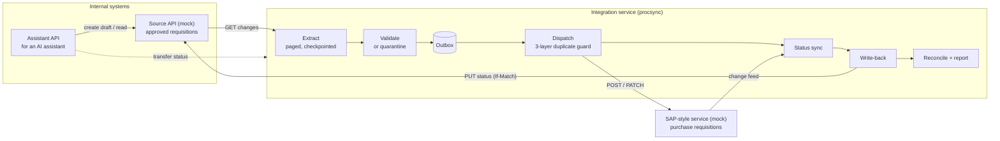

# Procurement Requisition Integration

An integration service in .NET 10 that reads approved purchase requisitions from an internal API, transfers them to an SAP-style service, and keeps their procurement status in sync. It is built to survive what real integrations hit: paging, rate limits, version conflicts, intermittent failures and malformed records. A rerun never creates a duplicate, and every outcome is explained in a reconciliation report.

It also includes an **AI-safe API contract** that a procurement assistant could use to raise requests and check their status, with the safety rules enforced by the server rather than trusted to the model.

All data is synthetic. No real SAP system is involved.

---

## Contents

| Deliverable | Where |
|---|---|
| Source code | [`src/`](src) |
| API specifications (OpenAPI 3.1) | [`api/assistant-api.openapi.json`](api/assistant-api.openapi.json), [`api/source-mock.openapi.json`](api/source-mock.openapi.json), [`api/sap-mock.openapi.json`](api/sap-mock.openapi.json) |
| AI assistant contract guide + MCP tool definitions | [`api/README.md`](api/README.md), [`api/mcp-tools.json`](api/mcp-tools.json) |
| Architecture note | [`docs/architecture.md`](docs/architecture.md) |
| Design decisions (ADRs) | [`docs/adr/`](docs/adr) |
| Test scenarios | [`docs/test-scenarios.md`](docs/test-scenarios.md) |
| Sample reconciliation reports | [`reports/sample/`](reports/sample) |
| Presentation notes | [`docs/presentation-notes.md`](docs/presentation-notes.md) |
| Execution instructions | this file |

---

## Quick start

**Prerequisite:** [.NET 10 SDK](https://dotnet.microsoft.com/download/dotnet/10.0). Nothing else: no Docker and no database server. The integration uses SQLite by default.

```bash
dotnet test                  # 91 tests, about 30 seconds
scripts/demo.sh              # guided demo (macOS/Linux); Windows: scripts/demo.ps1
```

The demo starts three local services, runs the sync under injected failures, and walks through quarantine, status sync, the AI assistant API and reconciliation. Press Enter between steps, or pass `--no-pause` (`-NoPause` in PowerShell). Stop the services afterwards with `scripts/stop-all.sh` (or `scripts/stop-all.ps1`).

### Running the pieces yourself (any OS)

```bash
dotnet build
dotnet run --project src/Mocks.SourceApi            # terminal 1 → http://localhost:5101
dotnet run --project src/Mocks.SapApi               # terminal 2 → http://localhost:5102
dotnet run --project src/Procurement.AssistantApi   # terminal 3 → http://localhost:5103
dotnet run --project src/Procurement.Sync.Worker -- run   # terminal 4, from the repository root
```

Or start the three services in the background with `scripts/run-all.sh` / `scripts/run-all.ps1`.

Each service has interactive API docs at `/scalar` (for example http://localhost:5103/scalar). Every run writes a report to `reports/` (open `reports/latest.html`) and keeps its state in `procsync.db` in the directory you run from.

---

## What it does



One **run** does the following, in order:

1. **Extract.** Reads every source change since the last checkpoint, page by page.
2. **Validate.** Checks each record on its own and quarantines the bad ones with a reason code.
3. **Stage.** Puts valid records in an outbox.
4. **Dispatch.** Sends them to SAP, after first looking SAP up by reference.
5. **Status sync.** Pulls SAP status changes.
6. **Write-back.** Writes the SAP number and status back to the source.
7. **Report.** Writes a reconciliation report that checks invariants against a full scan of SAP.

---

## How the requirements are met

| Requirement | Approach | Proven by |
|---|---|---|
| Read approved requisitions | Change-ordered keyset paging with a durable cursor; non-approved records are tracked as `Ignored` | S01, S02 |
| Transfer to SAP-style service | OData-flavoured mock (`A_PurchaseRequisitionHeader`, `to_PurchaseReqnItem`, ETags, SAP error format) | S01, mock tests |
| Read and sync status | SAP change feed with a watermark; statuses only move forward; written back with `If-Match` | S09, S16, S18 |
| **Pagination** | Opaque keyset cursor; checkpoint committed with each page; dedupe on `(id, version)` | S03, S12, mock tests |
| **Rate limits** | Client token bucket, `429` + capped `Retry-After`, exponential backoff with jitter | S06 |
| **Version conflicts** | ETag / `If-Match` on both systems, a clear ownership rule, re-read and re-apply on `412`, quarantine once SAP has frozen the record | S11, S13, S18 |
| **Intermittent failures** | Microsoft's standard resilience handler (retry, circuit breaker, timeouts); unknown outcomes go `InDoubt` and are checked before any resend | S04, S07, S08, S15 |
| **Malformed records** | Each record is parsed on its own with field-level problems, then business rules; closed set of reason codes | S01 (all 11 defect types) |
| **Reruns never duplicate** | (1) local SAP-number mapping, (2) deterministic `Idempotency-Key`, (3) lookup by external reference before every create | S02, S04, S05, S20 |
| **Failed records quarantined** | `Quarantine` table with raw payload; auto-released when the source fixes the record; replay and resolve commands | S10, S21, S22 |
| **Reconciliation report** | JSON + Markdown + HTML per run: six invariants checked against a SAP scan, totals per currency, every failure with a suggested action | S19, S20 |
| **AI-safe API contract** | Draft-only, catalogue pricing, required idempotency key, strict schema, scoped tokens, actionable errors, MCP hints | A01-A09 |
| Synthetic data only | Deterministic seeded generator; fictitious codes; `example.test` addresses | — |

The seeded data set has 250 requisitions: 207 approved, 43 in other states. Of the approved ones, 17 are deliberately malformed (10 kinds of defect) and 6 are valid in the source but rejected by SAP (a plant outside the company code). A clean run ends with **184 in SAP, 23 quarantined with a reason, 0 duplicates**. The [chaos sample report](reports/sample/chaos-run.md) shows the same result with 10% `503`s, 5% `429`s and 3% lost responses switched on.

---

## Command line (`procsync`)

Run from the repository root with `dotnet run --project src/Procurement.Sync.Worker -- <command>`, or with `dotnet src/Procurement.Sync.Worker/bin/Debug/net10.0/procsync.dll <command>` after a build.

| Command | What it does |
|---|---|
| `run` | One full cycle. Exit code 0 = clean, 1 = completed with issues (pending retries), 3 = skipped because another run holds the lease |
| `serve --interval 60` | Runs cycles continuously (the scheduled mode) |
| `status <id>` | Where one requisition stands: state, SAP number, ERP status, history, quarantine |
| `quarantine list [--reason R] [--all]` | Open (or all) quarantine entries |
| `quarantine show <id>` | One entry with the suggested action, problem details and raw payload |
| `quarantine replay <id>` | Re-reads the requisition from the source and pushes it through again |
| `quarantine resolve <id> --note "..."` | Closes an entry that was handled outside the integration |
| `reconcile` | Checks the invariants against SAP and writes a report, without syncing |

## Configuration

Settings live in `src/Procurement.Sync.Worker/appsettings.json` and can be overridden with environment variables (for example `Sync__SapBaseUrl`, `Sync__Resilience__PermitsPerSecond`).

| Setting | Default | Meaning |
|---|---|---|
| `Sync:SourceBaseUrl` / `Sync:SapBaseUrl` | localhost:5101 / :5102 | Downstream endpoints |
| `Sync:PageSize` | 50 | Source page size (1-100) |
| `Sync:Parallelism` | 4 | Concurrent requisitions sent to SAP |
| `Sync:MaxDispatchAttempts` | 5 | Attempts before a record is quarantined as `RetryExhausted` |
| `Sync:RetryPendingBaseDelay` | 30s | First wait before a retry (doubles each attempt) |
| `Sync:Resilience:*` | see file | Retries, backoff, `Retry-After` cap, timeouts, circuit breaker, client rate limit |
| `Store:Provider` + `ConnectionStrings:SyncStore` | `Sqlite`, `procsync.db` | Set `SqlServer` and a connection string for SQL Server / Azure SQL |

The mocks accept chaos settings at runtime (`PUT /_admin/faults`) or in their `appsettings.json` (`Faults` section). See [docs/test-scenarios.md](docs/test-scenarios.md#fault-injection).

---

## Tests

```bash
dotnet test
```

- **Unit tests** (`tests/Procurement.Sync.UnitTests`): retry rules, parsing and validation of every defect type, SAP mapping, fingerprints, the state store (concurrency token, outbox uniqueness, lease).
- **Scenario tests** (`tests/Procurement.ScenarioTests`): the real sync services against both mocks hosted in-process, with faults injected. They cover S01-S22 for the pipeline, A01-A09 for the assistant API, and the mocks' own contracts. The production resilience pipeline runs unchanged; only the waits are scaled down, so retries, `Retry-After` and the circuit breaker are exercised in milliseconds.

See [docs/test-scenarios.md](docs/test-scenarios.md) for the full catalogue mapped to requirements.

---

## Repository layout

```
src/
  Procurement.Contracts/      canonical model, ERP status, quarantine reasons
  Procurement.Sync/           the integration: clients, resilience, pipeline stages, store, reporting
  Procurement.Sync.Worker/    procsync CLI and scheduled worker host
  Procurement.AssistantApi/   AI-facing API (draft, validate, status, withdraw, reference data)
  Mocks.SourceApi/            internal requisition system (synthetic data, cursor paging, ETags)
  Mocks.SapApi/               SAP-style purchase requisition service (OData-flavoured)
  Mocks.Shared/               fault injection, rate limiting, cursors, ETags
tests/
  Procurement.Sync.UnitTests/
  Procurement.ScenarioTests/
api/        OpenAPI documents and MCP tool definitions
docs/       architecture note, ADRs, test catalogue, presentation notes
scripts/    run-all, stop-all, demo (bash + PowerShell), export-api
reports/    run reports (git-ignored), sample/ committed
```

## Out of scope, and what would change for production

Real SAP connectivity, the approval workflow, the AI assistant itself and any user interface are out of scope, as the brief specifies. The [architecture note](docs/architecture.md#13-production-path) covers what a production rollout would add:
- SAP's CSRF token handshake and `$batch` calls;
- OAuth or X.509 authentication;
- SQL Server with migration bundles;
- Azure Service Bus behind the outbox, and competing workers;
- OpenTelemetry exported to Application Insights;
- tokens from Entra ID issued on behalf of the user.
