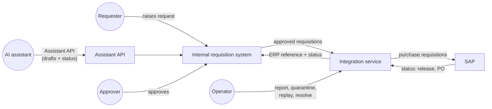
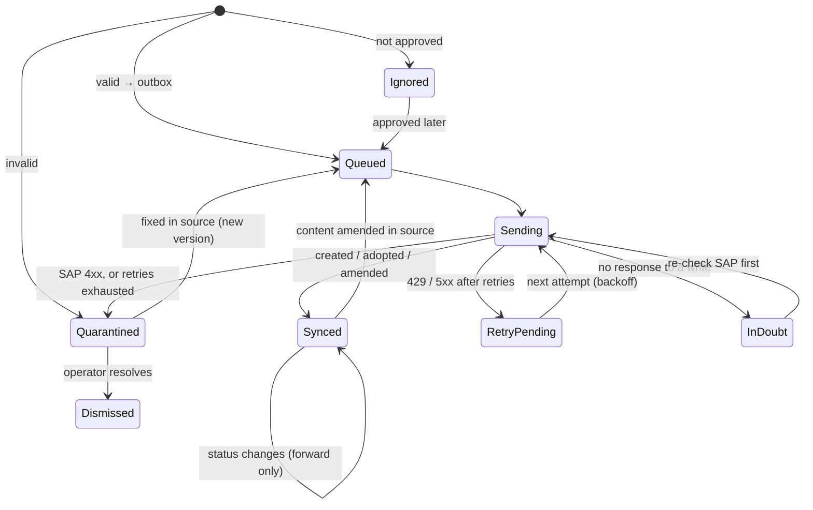
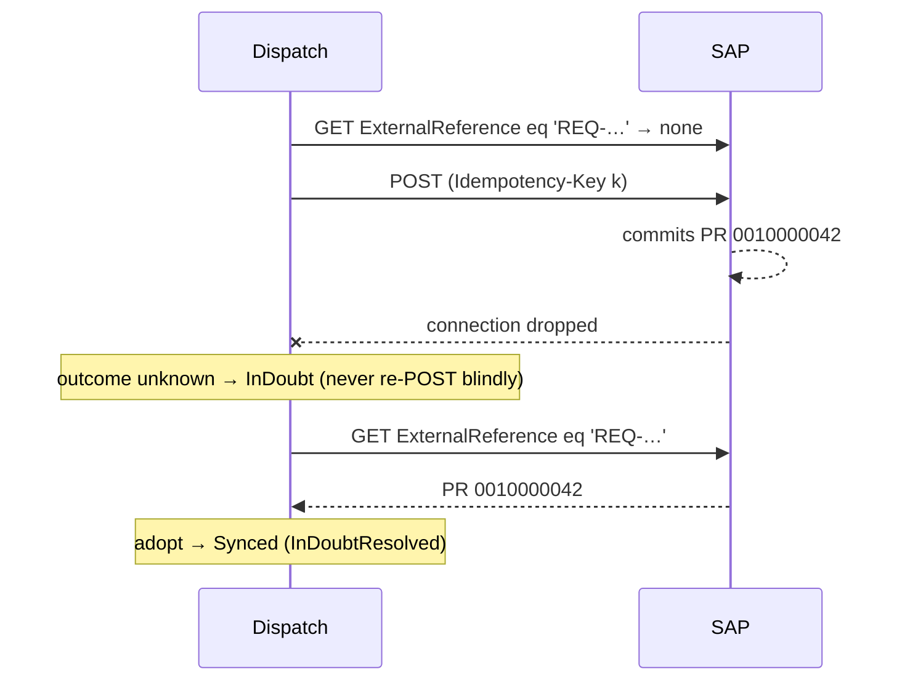

# Architecture note

This note explains how the integration is put together and why. The short version:

> **At-least-once delivery, idempotent effects.** Every step may be repeated: after a crash, a timeout, a lost response or a rerun. Each step is written so that repeating it changes nothing. "Exactly once" is not something any network gives you; this design produces it as the observable outcome.

Decisions with real alternatives are recorded as ADRs in [`adr/`](adr).

---

## 1. Context and scope



| In scope | Out of scope (per the brief) |
|---|---|
| Integration service, mock source API, mock SAP-style service, AI-facing API contract (implemented, so it can be tested), synthetic data | Real SAP connectivity, approval workflow, the AI assistant itself, any UI |

**Data.** By default the mocks serve the client's synthetic data pack, read straight from the Excel workbook ([`data/README.md`](../data/README.md), [ADR-0009](adr/0009-client-data-pack.md)). A generated 250-record set is kept for stress and edge-case tests.

The mocks behave like awkward real systems on purpose:
- The **source** pages through changes and versions every record with ETags. It serves malformed records exactly as a flawed upstream would.
- The **SAP mock** follows SAP's purchase requisition API shapes: field names, `to_PurchaseReqnItem`, the SAP error envelope, release and processing status codes, and refusing content changes once a requisition is released. With the workbook it also acts as the client's mock remote:
  - it uses the workbook's document numbers (`MOCK-SAP-5xxxx`);
  - it already holds seven documents;
  - it plays the workbook's failure schedule (`429` with `Retry-After: 20`, `503`, and `409` for a stale version);
  - it answers a second create for the same reference with `409` and the existing document id.

  With the generated set it allows duplicate references, as real SAP does.
- **Both** can inject `503`s, `429`s with `Retry-After`, latency and lost responses, and both have real token-bucket rate limiting.

## 2. Components

| Component | Responsibility |
|---|---|
| `Procurement.Sync` | The integration: typed HTTP clients with resilience pipelines, pipeline stages, EF Core state store, reconciliation reporting |
| `Procurement.Sync.Worker` | `procsync` CLI (`run`, `serve`, `status`, `quarantine …`, `reconcile`, `check-expected`) and the scheduled worker |
| `Procurement.AssistantApi` | AI-facing API: validate, create draft, read status, withdraw, reference data |
| `Procurement.Contracts` | Canonical model shared by the integration and the assistant API: `Requisition`, `ErpStatus`, `QuarantineReason` |
| `Mocks.SourceApi`, `Mocks.SapApi`, `Mocks.Shared` | The two external systems and their shared fault injection |
| `Procurement.SyntheticData` | Reads the client's workbook (Open XML SDK) and the employee directory; used by the mocks, the Assistant API's catalogue and the tests, never by the integration |

The mocks do **not** share types with the integration. Each side has its own wire model, so a mismatch in field names or shapes shows up in the tests, as it would against real systems.

## 3. A run, step by step

```mermaid
sequenceDiagram
    autonumber
    participant R as SyncRunner
    participant DB as State store
    participant S as Source API
    participant P as SAP
    R->>DB: acquire lease (one runner at a time)
    R->>DB: Sending → InDoubt (crash recovery)
    loop each page from checkpoint
        R->>S: GET /api/requisitions?cursor=…
        R->>DB: validate each record → quarantine or stage in outbox,<br/>save checkpoint (one transaction per page)
    end
    loop each due outbox message (parallel, bounded)
        R->>P: GET by ExternalReference (look before create)
        alt not in SAP
            R->>P: POST with Idempotency-Key
        else in SAP, older content
            R->>P: PATCH with If-Match
        end
        R->>DB: Synced / RetryPending / InDoubt / Quarantined
    end
    R->>P: GET change feed since watermark
    R->>DB: apply forward-only status changes
    R->>S: PUT erp-status with If-Match (re-read on 412)
    R->>P: full scan for invariants
    R->>DB: run summary; write report (JSON, MD, HTML)
    R->>DB: release lease
```

The stages are independent:
- If **extract** fails partway, dispatch still sends everything staged so far, because those records are valid.
- If the **SAP circuit breaker** opens, the remaining messages stay queued and the run ends cleanly.
- If **status polling** stops early, it resumes from its watermark next time.

## 4. State and the record lifecycle

The store has eight tables:

| Table | Holds |
|---|---|
| `Requisitions` | Per-record integration state |
| `Outbox` | Work to send to SAP |
| `Quarantine` | Failures, with the raw payload |
| `Checkpoints` | Source cursor and SAP watermark |
| `Runs` and `RunEvents` | What each run did; reports are built from these |
| `StatusHistory` | ERP status changes over time |
| `Leases` | The single-runner lock |



- A record is `Sending` only while a call to SAP is in flight. That state is saved **before** the call, so a crash leaves evidence: the next run turns `Sending` into `InDoubt`.
- An `InDoubt` record is never re-sent blindly. SAP is checked first.

## 5. Never creating a duplicate

Three independent layers. Any one of them would prevent most duplicates; together they cover the failure modes each misses.

| Layer | Mechanism | Covers | Misses on its own |
|---|---|---|---|
| 1. Local mapping | A record with a SAP number is only ever amended (`PATCH`), never created again | Reruns, re-extraction, page overlap | Local state lost or reset |
| 2. Idempotency key | `Idempotency-Key = hash(id, version)`, the same on every retry; SAP replays the first response | Lost responses, retried creates | Real SAP doesn't honour the header; keys expire |
| 3. Look before create | `GET …?$filter=ExternalReference eq '<id>'` before every `POST`, and again right after an unknown outcome | Lost responses, lost local state, systems without idempotency keys | A create still in flight when the lookup runs (layer 2 covers this with `409`) |



Layer 3 is the one that would still work against a real SAP, which doesn't support `Idempotency-Key`. A mock test proves why it matters: with key support switched off, a blind retry after a lost response **does** create a duplicate (`Without_idempotency_support_a_blind_retry_creates_a_duplicate`).

**If SAP still answers "duplicate".** The client's mock remote answers a create for a reference it already holds with `409 DUPLICATE_REFERENCE` and the existing document id. The integration reads that document and links to it, exactly as if the lookup had found it (W05, where SAP's search is made to lag).

Two details make this hold in practice:
- **The transport never repeats a POST on an unknown outcome.** Only `429`/`503` are retried for POST, because those mean the server did nothing. Timeouts, resets and `5xx` on a POST are handed back to the pipeline as `Ambiguous`.
- **Content is compared before amending.** The integration's own status write-back bumps the source version without changing content. After a loss of local state, "SAP holds v2, source is v3" would otherwise trigger a pointless `PATCH`. Scenario S05 caught this.

The [reconciliation report](#8-quarantine-and-reconciliation) then *proves* the result against a full SAP scan: no external reference appears twice.

## 6. Failure handling

| Failure | Detected by | Response | Test |
|---|---|---|---|
| `429` with `Retry-After` | Status code | Wait the server's `Retry-After` (capped at 30s, so one response can't stall a run), then retry; a client token bucket keeps traffic under the limit | S06 |
| `503`, timeout, reset on a read | Status / exception | Exponential backoff with jitter, up to 4 retries | S07 |
| `500`/`502`/`504`/reset on a POST | Status / exception | **No transport retry.** `InDoubt`, re-check SAP, then retry or adopt | S04, S15 |
| SAP down | Circuit breaker opens (≥50% failures over 30s, minimum 10 calls) | Stop dispatching, leave the outbox queued, end the run cleanly; resume next run | S08 |
| Source down mid-read | Exception from paging | Keep pages already committed; dispatch what was staged; next run resumes from the checkpoint | S03 |
| Persistent transient failure | Attempt counter | Exponential `RetryPending` delay; quarantine `RetryExhausted` after 5 attempts; `replay` once SAP is healthy | S21 |
| SAP `4xx` business error | Status + SAP error body | Quarantine `SapRejectedPermanent` with SAP's message; never retried | S01 |
| SAP `409` duplicate reference | Error code + existing document id | Read and link the existing document; nothing created | W05 |
| SAP `409` version conflict on create | Error code + current version | Re-read the requisition from the source, validate it, resend once; quarantine `VersionConflictUnresolved` if SAP still refuses | W01 |
| Malformed record | Parser and validator | Quarantine with every problem and its field path; other records unaffected | S01 |
| Crash mid-send | `Sending` state at startup | `InDoubt` → re-check SAP | (by construction; S15 covers the re-check) |
| Two runs at once | Lease row (conditional update) | Second run exits with code 3 | S17 |

Retry policy lives in two places, deliberately:
- **Transport retries**, in Polly via `Microsoft.Extensions.Http.Resilience`, handle brief blips within one call.
- **Pipeline retries**, using `RetryPending` with `NextAttemptAt`, handle outages that outlast a call.

## 7. Version conflicts and ownership

**Rule:** the source owns *what is requested* (content). SAP owns *what happens to it* (release, purchase order, closure).

| Situation | Response | Test |
|---|---|---|
| Source edited while a create is in flight; SAP knows the newer version | `409 VERSION_CONFLICT` → re-read the source (the owner of content), send the newer version once | W01 (`REQ-7002`: v2 refused, v3 created) |
| Source content changes, SAP PR still `Created`/`InRelease` | `PATCH` with `If-Match`; on `412` re-read SAP and decide again (up to 3 times) | S11 |
| Source content changes after SAP release | SAP refuses changes, so: quarantine `VersionConflictUnresolved` with instructions; SAP keeps the earlier valid version | S13 |
| Source cancelled after transfer | Quarantine `SourceChangedAfterTransfer` so a person cancels the SAP PR; never auto-cancelled | S14 |
| Source edited while we write back status | `412` → re-read the source, re-apply only the status fields | S18 |
| SAP status arrives out of order | Statuses only move forward; older ones are logged and ignored | S16 |
| Same version delivered twice (page overlap) | Dedupe on `(id, version)` | S12 |

Locally, `Requisitions.Revision` is an EF Core concurrency token, so two workers can't silently overwrite each other's update to the same record.

## 8. Quarantine and reconciliation

**Quarantine** keeps the raw payload, the stage, a reason from a closed set (`QuarantineReason`), every individual problem with its field path, and occurrence counts. An entry is closed in one of three ways:
- **Automatically,** when the source publishes a corrected version (S10).
- **By `procsync quarantine replay <id>`,** after the cause was fixed elsewhere, such as SAP configuration or an outage (S21).
- **By `procsync quarantine resolve <id> --note`,** when it was handled outside the integration (S22). The record becomes `Dismissed`.

**The reconciliation report** is written after every run as JSON (for machines), Markdown (for repos and chat) and HTML (for people). It contains:

| Invariant | How it's checked |
|---|---|
| Every approved requisition is accounted for | Each is `Synced`, `Quarantined` (with an open entry), `Dismissed`, or pending retry. Nothing is silently dropped. |
| No duplicate requisitions in SAP | Full SAP scan, grouped by external reference |
| Every synced requisition exists in SAP | Local SAP numbers ⊆ SAP scan |
| Every SAP requisition is linked | Flags SAP records that no local record points to |
| Amounts match | Count and amount per currency, source vs SAP, comparing only the versions SAP actually holds |
| Source shows the current SAP status | No status write-back left pending |

The report also contains:
- what happened in the run (counts per event, retries, throttling and wait time);
- where every record stands;
- each open failure with a plain-English suggested action;
- notable events;
- records waiting for retry;
- **one row per requisition** the run touched. Each row gives:
  - the result (`Created`, `Duplicate`, `Updated`, `Quarantined`, `Skipped`, `Pending`, `Unchanged`);
  - the SAP document;
  - the number of SAP attempts, including transport retries;
  - a failure category (`Validation`, `Idempotency`, `Version conflict`, `Rate limit`, `Transient service`, `Lost response`, `Not approved`);
  - a one-line explanation, such as "Created after two rate-limit responses as MOCK-SAP-50003".

  The columns match the client's `Reconciliation_Expected` sheet, and the rows are also written as CSV for Excel. Attempts are counted by a handler inside the resilience pipeline, so it sees every retry.

Samples:
- [`workbook-first-run.md`](../reports/sample/workbook-first-run.md), the client's data: all 120 rows match `Reconciliation_Expected`;
- [`chaos-run-generated.md`](../reports/sample/chaos-run-generated.md), the generated set under random failures;
- [`after-demo-reconcile.md`](../reports/sample/after-demo-reconcile.md).

## 9. Status synchronisation

- SAP's change feed is read since a watermark (`LastChangeDateTime gt …`), re-reading a 2-second overlap in case timestamps collide. Re-applying a status is harmless because statuses only move forward.
- SAP codes are mapped to a canonical `ErpStatus`:

  | SAP processing / release status | `ErpStatus` |
  |---|---|
  | `N` / `""` | `Created` |
  | `N` / `01` | `InRelease` |
  | `N` / `02` | `Released` |
  | `B` | `PoCreated` |
  | `L` | `Closed` |
  | `N` / `08` | `Rejected` |

- Each change is appended to `StatusHistory`, then written back to the source with the SAP number, the status and a plain-language message.

## 10. The AI assistant API

The contract is described in [`api/README.md`](../api/README.md). The design follows OWASP's LLM06 *Excessive Agency* guidance: least privilege, and controls enforced by the server, not by the prompt.

- **Draft-only writes.** Requests are created as `PendingApproval`. The assistant can withdraw its own pending drafts but can never approve, release or order anything.
- **No invented data.** Codes must come from the reference endpoints, and prices come from the catalogue: the assistant sends material codes and quantities only. Unknown fields, quoted numbers and anything over the limits are rejected, and the published schema says so (`additionalProperties: false`, min/max).
- **Safe retries.** `Idempotency-Key` is required. The same key and body replay the first response; a different body is `422`. The API also looks the request up in the source before creating, so a lost response cannot create a second draft (A08).
- **Identity and scope.** User-delegated JWTs with the scopes `requisitions:read`, `requisitions:draft` and `requisitions:read:all` (delegated procurement role). Users see their own requests; someone else's returns `403 NOT_YOUR_REQUISITION`, as the client's contract tests specify. Rate limits apply per user.
- **The user confirms exactly what is created.** `validate` returns a plain-language `confirmationSummary` and a `confirmationToken` bound to the user and the exact request. Create requires that token in `X-User-Confirmation`. A request changed after the user agreed is refused with `CONFIRMATION_MISMATCH`.
- **Errors an agent can act on.** RFC 9457 problem details with a stable `code`, `retryable`, `retryAfter`, `invalidFields[]` (each with a suggestion) and `suggestedAction`.
- **Status the assistant can relay as written.** A closed `RequestStatus`, plus a `statusReason`, `nextExpectedStep` and a timeline.
- **Tool hints.** Every operation carries `x-mcp` hints (`readOnlyHint`, `idempotentHint`, `destructiveHint`) and an `operationId`. [`mcp-tools.json`](../api/mcp-tools.json) is generated from them. Only `withdrawRequisitionRequest` is destructive, which tells an MCP client to ask the user first.

## 11. Observability

- **Structured logs** per stage, via `ILogger`, with Polly's retry telemetry.
- **Per-run metrics:** retries and throttling per downstream, retry wait time, and breaker openings (`RunMetrics`, included in every report).
- **`/health` on every service.** The run report is the operational record; `Runs` and `RunEvents` keep its history queryable.
- **Production:** export the same signals through OpenTelemetry to Application Insights or Prometheus. Alert on breaker openings, growth in open quarantine, `Pending` above a threshold, and run duration.

## 12. Security

- The Assistant API validates JWTs (issuer, audience, signature, lifetime) and enforces scopes with authorization policies. Development tokens come from `/dev/token`, which exists **only** in the Development environment. Production would use the organisation's identity provider, such as Entra ID, issuing tokens on behalf of the signed-in user.
- No secrets live in source control. The development signing key is labelled as such; production keys come from the identity provider's signing keys or Key Vault.
- A vulnerable transitive package (`System.Security.Cryptography.Pkcs` via `Microsoft.Data.SqlClient`) is pinned to a patched version through central package management, and warnings are treated as errors.
- The mocks' `/_admin` endpoints are test controls, not part of any contract.

## 13. Production path

| Concern | Here | In production |
|---|---|---|
| SAP connectivity | OData-style mock | `API_PURCHASEREQUISITION_2` (OData V4) or `API_PURCHASEREQ_PROCESS_SRV` (V2), with the `x-csrf-token: fetch` handshake, `$batch` for lookups and creates, and OAuth 2.0 / X.509 via SAP BTP. Alternatively SAP Integration Suite or the Azure Logic Apps SAP connector. |
| Duplicate lookup | One `GET` per create | One batched `$filter=ExternalReference in (…)` per page |
| Store | SQLite, `EnsureCreated` | SQL Server / Azure SQL (provider switch already in place) with EF migration bundles ([ADR-0003](adr/0003-sqlite-default-sql-server-ready.md)) |
| Queue | Outbox drained in-process | Outbox relay to Azure Service Bus or RabbitMQ; competing consumers, sessions keyed by requisition id ([ADR-0004](adr/0004-transactional-outbox.md)) |
| Scale-out | One runner holds a lease | Partition by company code; `READPAST`/`UPDLOCK` work queues or Service Bus sessions; the lease becomes per partition |
| Change capture | Polling with a cursor and watermark | Webhooks or CDC where the source supports them, feeding the same outbox ([ADR-0005](adr/0005-polling-with-checkpoints.md)) |
| Assistant API | One instance, in-memory idempotency keys | Several instances behind an API gateway (APIM or YARP); keys in SQL or Redis; tokens from Entra ID |
| Hosting | Local processes | Containers on Azure Container Apps or App Service; the worker as a scheduled job |

## 14. Known limitations

- The SAP mock is SAP-*style*. Field names and codes follow the public API, but behaviour is simplified: there is one status pair per header, and no account assignment or texts.
- Reference data (currencies, units, plants, catalogue prices) is static and synthetic. In production it would be cached from master data.
- The client's workbook leaves some things open (company code and plant, who owns which requisition, how a version conflict comes about). The assumptions are listed in [`data/README.md`](../data/README.md#assumptions-and-questions-for-the-client).
- Status sync relies on SAP's change timestamps. A system that rewrites history without touching `LastChangeDateTime` would need a periodic full comparison; the reconciliation scan already provides the building block.
- The Assistant API keeps idempotency keys in memory. They survive retries but not a restart; [ADR-0007](adr/0007-ai-assistant-api-safety.md) records the trade-off.
